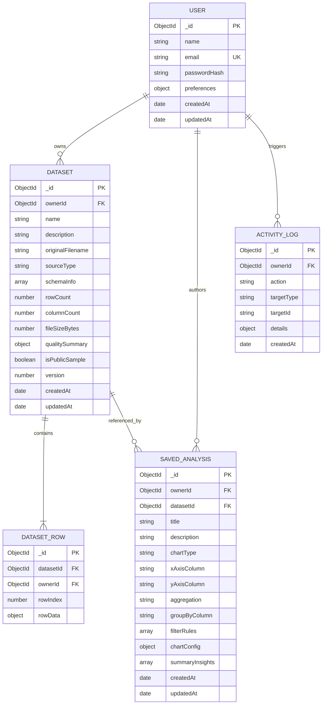

# DataLens Studio — Database Architecture & Schema Specification

This document details the MongoDB data models, indexes, relationship topologies, and cascading lifecycle rules implemented via Mongoose.

---

## 1. Entity-Relationship Overview

---

## 2. Collection Schemas & Field Definitions

### 2.1. `users` Collection
Stores analyst credentials and UI preferences. Plaintext passwords are never stored.

| Field Name | BSON Type | Validation / Constraints | Description |
|---|---|---|---|
| `_id` | ObjectId | Primary Key | Auto-generated unique identifier |
| `name` | String | Required, trimmed, 2–100 chars | User's full display name |
| `email` | String | Required, trimmed, lowercase, unique | User's primary login identifier |
| `passwordHash` | String | Required | 60-character bcrypt hash (salt >= 10) |
| `preferences.theme` | String | Enum: `['light', 'dark']`, Default: `'light'` | Persisted UI visual theme |
| `createdAt` | Date | Auto-populated | Account creation timestamp |
| `updatedAt` | Date | Auto-populated | Account last updated timestamp |

**Indexes:**
- `{ email: 1 }` (Unique)

---

### 2.2. `datasets` Collection
Stores metadata, inferred column schemas, and calculated quality scores for imported CSV files.

| Field Name | BSON Type | Validation / Constraints | Description |
|---|---|---|---|
| `_id` | ObjectId | Primary Key | Unique dataset identifier |
| `ownerId` | ObjectId | Ref: `'User'`, Required, Indexed | ID of the user who owns this dataset |
| `name` | String | Required, trimmed, 1–120 chars | Human-readable dataset title |
| `description` | String | Max 500 chars, Default: `''` | Optional descriptive context |
| `originalFilename` | String | Required, trimmed | Original source CSV filename |
| `sourceType` | String | Enum: `['upload', 'built-in-sample', 'cleaned-derived']` | Data provenance |
| `schemaInfo` | Array | Required | Array of column definitions: name, inferred type, min, max, uniqueCount, missingCount |
| `rowCount` | Number | Min: 1, Max: 10,000 | Total number of imported data rows |
| `columnCount` | Number | Min: 1, Max: 50 | Total number of columns |
| `fileSizeBytes` | Number | Min: 1, Max: 5,242,880 (5MB) | Physical file size |
| `qualitySummary` | Object | Required | `{ score, status, missingCells, missingPct, duplicateRows, outlierCount, issues }` |
| `isPublicSample` | Boolean | Default: `false` | Indicates whether this is a shared sample dataset |
| `version` | Number | Min: 1, Default: 1 | Incremented upon cleaning transformations |
| `createdAt` | Date | Auto-populated | Dataset upload timestamp |
| `updatedAt` | Date | Auto-populated | Last modification timestamp |

**Indexes:**
- `{ ownerId: 1, createdAt: -1 }` (Efficient listing of user datasets)
- `{ isPublicSample: 1 }` (Quick sample dataset resolution)

---

### 2.3. `dataset_rows` Collection
Stores bounded dataset rows individually to prevent hitting the 16MB MongoDB single-document BSON limit and allow server-side pagination, search, and sorting.

| Field Name | BSON Type | Validation / Constraints | Description |
|---|---|---|---|
| `_id` | ObjectId | Primary Key | Unique row identifier |
| `datasetId` | ObjectId | Ref: `'Dataset'`, Required, Indexed | Parent dataset foreign key |
| `ownerId` | ObjectId | Ref: `'User'`, Required, Indexed | Redundant owner ID for fast access control |
| `rowIndex` | Number | Required, Min: 0 | Zero-based row index in original CSV |
| `rowData` | Object (Mixed) | Required | Key-value dictionary of column names to typed values |

**Indexes:**
- `{ datasetId: 1, rowIndex: 1 }` (Compound index for deterministic pagination)
- `{ datasetId: 1, ownerId: 1 }` (Guards data ownership during row reads)

---

### 2.4. `saved_analyses` Collection
Stores interactive visualization states, chart choices, aggregations, and discovered insights.

| Field Name | BSON Type | Validation / Constraints | Description |
|---|---|---|---|
| `_id` | ObjectId | Primary Key | Unique analysis identifier |
| `ownerId` | ObjectId | Ref: `'User'`, Required, Indexed | Owner foreign key |
| `datasetId` | ObjectId | Ref: `'Dataset'`, Required, Indexed | Target dataset foreign key |
| `title` | String | Required, trimmed, 1–150 chars | Name of the analysis report |
| `description` | String | Max 1000 chars, Default: `''` | Analysis notes / takeaways |
| `chartType` | String | Enum: `['line', 'bar', 'doughnut', 'pie', 'scatter', 'histogram']` | Visualization archetype |
| `xAxisColumn` | String | Required | Column mapped to the X axis / category |
| `yAxisColumn` | String | Optional for histogram / count | Column mapped to the Y axis / measure |
| `aggregation` | String | Enum: `['sum', 'average', 'count', 'min', 'max', 'none']` | Mathematical aggregation function |
| `groupByColumn` | String | Optional | Secondary categorical grouping |
| `filterRules` | Array | Default: `[]` | Array of `{ column, operator, value }` |
| `chartConfig` | Object | Default: `{}` | Visual options (colors, legend, grid lines) |
| `summaryInsights` | Array | Default: `[]` | Snapshot of relevant insights generated |
| `createdAt` | Date | Auto-populated | Analysis creation timestamp |
| `updatedAt` | Date | Auto-populated | Last updated timestamp |

**Indexes:**
- `{ ownerId: 1, updatedAt: -1 }` (Listing user analyses)
- `{ datasetId: 1 }` (Cascading cleanup lookup)

---

### 2.5. `activity_logs` Collection
Audits critical user operations for security, demonstration verification, and compliance.

| Field Name | BSON Type | Validation / Constraints | Description |
|---|---|---|---|
| `_id` | ObjectId | Primary Key | Unique log identifier |
| `ownerId` | ObjectId | Ref: `'User'`, Required, Indexed | Actor user ID |
| `action` | String | Required | E.g., `DATASET_UPLOAD`, `ANALYSIS_SAVE` |
| `targetType` | String | Required | `dataset`, `analysis`, `account` |
| `targetId` | String | Required | Stringified ID of affected entity |
| `details` | Object | Default: `{}` | Non-sensitive event metadata |
| `createdAt` | Date | Default: `Date.now`, TTL: 90 days | Automatic TTL expiration index |

**Indexes:**
- `{ ownerId: 1, createdAt: -1 }`
- `{ createdAt: 1 }` (TTL: 7,776,000 seconds / 90 days)

---

## 3. Data Integrity & Cascading Deletion Strategy

1. **Strict Ownership Check:** Every request mutating or reading documents checks `doc.ownerId.equals(req.session.userId)`.
2. **Dataset Cascading Delete:**
   When a user deletes a dataset with ID `$DATASET_ID`:
   - `Dataset.deleteOne({ _id: $DATASET_ID, ownerId })`
   - `DatasetRow.deleteMany({ datasetId: $DATASET_ID })`
   - `SavedAnalysis.deleteMany({ datasetId: $DATASET_ID })`
   - All operations are batched; any partial failure logs an error to ensure orphan rows are not left behind.
3. **Account Deletion:**
   When a user deletes their account:
   - Identify all datasets owned by user.
   - Delete all corresponding `DatasetRow` documents.
   - Delete all `SavedAnalysis` documents.
   - Delete all `Dataset` records.
   - Delete all `ActivityLog` entries.
   - Delete the `User` record and destroy the active session.
